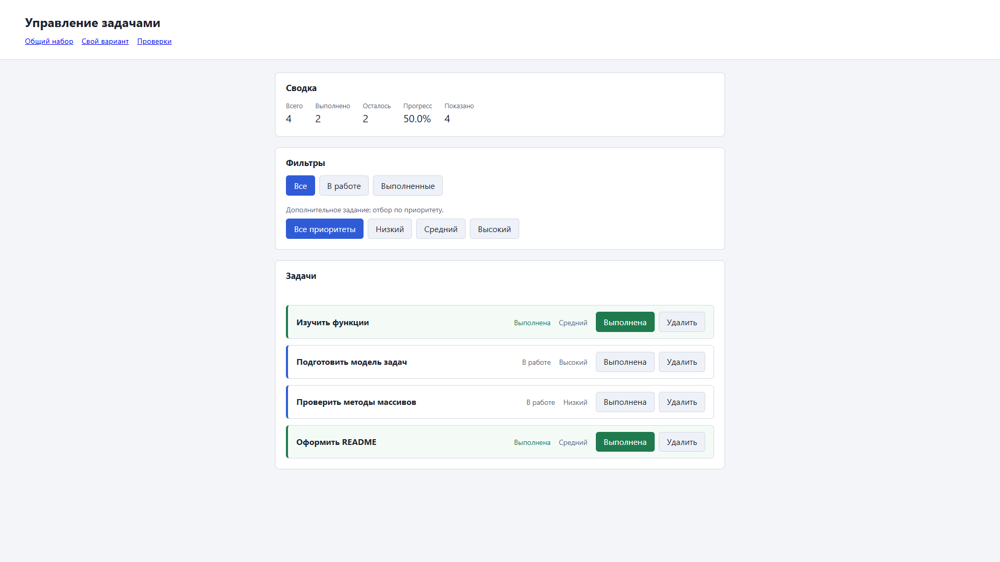

# Практическая работа № 3 — отчёт

**Тема:** работа с DOM и событиями.



## 1. Автор, вариант и окружение

| Поле | Значение |
|---|---|
| Имя | Косатый Никита |
| Группа | ЭФБО-16-25 |
| Вариант | 6 — «Проверка пользовательского интерфейса» |
| Node.js | `v24.16.0` |
| npm | `11.13.0` |
| Браузер | Chromium (Chrome / Edge), DevTools |
| ОС | Windows 10/11 (10.0.26200) |

## 2. Запуск

Из папки **`practice-03`**:

```bash
npm start
```

Терминал выводит адрес `http://127.0.0.1:5503/`. Альтернатива — `node tools/serve.mjs`; при занятом
порте `node tools/serve.mjs 5504`. Терминал с сервером остаётся работающим, Git-команды выполняются
в другой вкладке.

| Адрес | Назначение |
|---|---|
| `http://127.0.0.1:5503/` | Приложение, общий набор |
| `http://127.0.0.1:5503/index.html?dataset=variant` | Приложение, набор своего варианта |
| `http://127.0.0.1:5503/examples/dom-events.html` | Эксперименты задания 1 |
| `http://127.0.0.1:5503/checks.html` | Браузерные проверки |

Проверка функций ПР2 (из папки `practice-03`): `npm run check:service`. Из корня репозитория:
`node practice-03/checks/service.checks.js`.

Двойной щелчок по `index.html` не подходит: в странице подключён
`<script type="module" src="./src/main.js">`, а для модулей нужен запуск по `http://`, а не `file://`.
Устанавливать зависимости не требуется — локальный сервер написан на стандартных модулях Node.js.

## 3. Перенос предыдущей работы

Из корня личного репозитория:

```powershell
Copy-Item .\practice-02\src\task-service.js .\practice-03\src\task-service.js
Copy-Item .\practice-02\src\data.js .\practice-03\src\data.js
```

Перенесены собственные проверенные `task-service.js` и `data.js`. `main.js` из ПР2 не переносился:
там был консольный сценарий. В `task-service.js` нет обращений к `document`, поиска кнопок и
вывода сообщений.

Фактический результат проверки предыдущего этапа:

```text
> npm run check:service
Всего: 35. Пройдено: 35. Ошибок: 0.
```

Ожидания проверок не изменялись.

## 4. Задание 1. Исследование DOM и распространения события

Страница: `http://127.0.0.1:5503/examples/dom-events.html`.

| № | Эксперимент | Прогноз до запуска | Фактический результат | Объяснение |
|---:|---|---|---|---|
| 1 | Отсутствующий элемент и пустая коллекция | `querySelector` → `null`; `querySelectorAll(...).length` → `0` | `null` (тип `object`); длина `0`, результат — `NodeList` | `querySelector` возвращает `null`, если совпадения нет, а `querySelectorAll` — пустую коллекцию, а не `null`. Обращение `missing.textContent` вызвало бы `TypeError`, поэтому перед чтением свойств нужна проверка. |
| 2 | Чтение `dataset.taskId` | До преобразования `"23"` (`string`), после `Number` → `23` (`number`) | `"23"` / `string`; `23` / `number` | В `dataset` все значения — строки, а дефисное имя `data-task-id` превращается в свойство `taskId`. Дополнительно видно: `Number("4abc")` → `NaN`, а `parseInt("4abc", 10)` → `4`, поэтому для идентификатора используется `Number`, а не частичный разбор. |
| 3 | Двойное нажатие «Добавить запись» | Сохранённый `initialItems.length` остаётся `2`, новый запрос даёт `3`, затем `4` | `2` и `3`; после второго нажатия `2` и `4` | Коллекция `querySelectorAll` статическая: это снимок на момент запроса. Для актуального состояния нужен новый запрос. |
| 4 | Нажатие «Изменить заголовок» | В заголовке появится строка `<strong>Проверить пример</strong>` как текст; элемент `strong` не создастся | Строка выведена с угловыми скобками; `heading.querySelector("strong")` → `null`; `childElementCount` → `0` | `textContent` записывает значение как текстовый узел и не разбирает его как HTML. |
| 5 | Нажатие по вложенному `span` | Сначала фаза захвата на `ul` (`eventPhase 1`), затем цель `span` (`2`), затем всплытие на `button` и `ul` (`3`); `target` всегда `span`, `currentTarget` меняется | Журнал: `ul, фаза захвата` → `span (цель)` → `button, всплытие` → `ul, всплытие`; `target` = `span` во всех записях, `currentTarget` = `ul`, `span`, `button`, `ul` | `target` — исходная цель события, `currentTarget` — элемент, чей обработчик выполняется сейчас. После обработки на цели событие всплывает по цепочке предков, поэтому обработчик контейнера получает нажатие на вложенный элемент. Именно это делает возможным делегирование и объясняет, почему читать `event.target.dataset.action` напрямую ненадёжно: атрибут находится у кнопки, а не у `span`. |

Дополнительно в DevTools поставлена точка останова в обработчике кнопки эксперимента 5: в момент
остановки `event.target` указывает на `span#bubbling-span`, а `event.currentTarget` — на
`button#bubbling-button`.

## 5. Распределение ответственности между модулями

| Файл | Ответственность | Чего в нём нет |
|---|---|---|
| `src/data.js` | Общий и индивидуальный наборы, номер варианта | Работы с DOM и изменения текущего списка |
| `src/task-service.js` | Проверенные прикладные функции ПР2 | `document`, кнопок, фильтра интерфейса, глобального массива |
| `src/task-selectors.js` | `getVisibleTasks` и (расширение) `getTasksByPriority` | Изменения входных задач и DOM |
| `src/task-view.js` | `createTaskElement`, `renderTaskList`, `renderSummary`, `renderEmptyState` | Изменения задач и подписок на события |
| `src/main.js` | `currentTasks`, `currentFilter`, `renderApp`, `handleTaskListClick`, `handleFilterClick` | Повторной реализации поиска, удаления и расчёта прогресса |

Состояние организовано так: `currentTasks` хранит **все** актуальные задачи, `currentFilter` —
режим отображения, а видимая выборка вычисляется отдельно при каждой отрисовке. Отфильтрованная
выборка никогда не записывается в `currentTasks`, поэтому кнопка «Все» возвращает скрытые записи.

Подписки назначены контейнерам один раз, вне `renderApp`: при отрисовке заменяются только дочерние
карточки, сам `ul#task-list` сохраняется вместе с обработчиком.

## 6. Задание 2. Карточка задачи и отображение списка

Структура карточки соответствует требованиям: корневой `li.task-card` с `data-task-id` (и
`is-completed` у выполненной), `h3.task-title` с полным названием, `.task-status` со строго
`Выполнена` / `В работе`, `.task-priority` со значениями `Низкий` / `Средний` / `Высокий`, кнопки
`button[type="button"]` с `data-action="toggle"` (и `aria-pressed`) и `data-action="delete"`,
внутри каждой — `span.action-label` с текстом `Выполнена` и `Удалить`.

Проверка безопасного вывода: для названия `<strong>Проверка</strong> & "кавычки"` в карточке
появляется именно эта строка, `title.querySelector("strong")` возвращает `null`,
`childElementCount` равен `0`. `innerHTML`, `outerHTML` и `insertAdjacentHTML` в построении
карточек не используются.

Два последовательных вызова `renderTaskList` с одинаковыми данными оставляют четыре карточки, а не
восемь; передача `[]` убирает карточки, но сам `ul#task-list` остаётся в документе
(`isConnected === true`).

## 7. Задание 5. Общий сценарий

Фактический прогон приложения по адресу `http://127.0.0.1:5503/index.html` после перезагрузки.
Показатель «Показано» равен длине массива видимых идентификаторов.

| Шаг | Действие и текущий фильтр | Ожидание (видимые id / всего / выполнено / осталось / прогресс) | Фактический результат | Итог |
|---:|---|---|---|---|
| 0 | Исходный набор, «Все» | `[1, 4, 7, 10]` / 4 / 2 / 2 / `50.0%` | `[1,4,7,10]`, 4, 2, 2, `50.0%`, показано 4 | Пройдено |
| 1 | Выбрать «В работе» | `[4, 7]` / 4 / 2 / 2 / `50.0%` | `[4,7]`, 4, 2, 2, `50.0%`, показано 2 | Пройдено |
| 2 | Отметить выполненной `id = 4` | `[7]` / 4 / 3 / 1 / `75.0%` | `[7]`, 4, 3, 1, `75.0%`, показано 1 | Пройдено |
| 3 | Выбрать «Все» | `[1, 4, 7, 10]` / 4 / 3 / 1 / `75.0%` | совпало, показано 4 | Пройдено |
| 4 | Удалить `id = 7` | `[1, 4, 10]` / 3 / 3 / 0 / `100.0%` | совпало, показано 3 | Пройдено |
| 5 | Выбрать «В работе» | `[]` / 3 / 3 / 0 / `100.0%`, сообщение об отсутствии совпадений | `[]`, показано 0, `Нет задач по выбранному фильтру.` | Пройдено |
| 6 | Выбрать «Все», переключить `id = 1` | `[1, 4, 10]` / 3 / 2 / 1 / `66.7%` | совпало, показано 3 | Пройдено |
| 7 | Последовательно удалить `1`, `4`, `10` | `[]` / 0 / 0 / 0 / `0.0%`, сообщение о пустом списке | `[]`, 0, 0, 0, `0.0%`, `Список задач пуст.` | Пройдено |

После перезагрузки страница возвращается к шагу 0: сохранения в ПР3 нет, это ожидаемо.

Переключение фильтров несколько раз подряд и одно нажатие кнопки статуса меняют ровно одну запись:
обработчики назначаются один раз, поэтому накопления реакций не происходит. Нажатие с клавиатуры
(Tab до кнопки, Enter) работает; после перерисовки фокус возвращается на то же действие той же
задачи, а при исчезновении карточки — на активный фильтр. Фактически после шага 7 активным
элементом оказалась кнопка `button[data-filter="all"].is-active`.

### Отладка через DevTools

Точка останова поставлена на строке чтения `card.dataset.taskId` в `handleTaskListClick`.

| Наблюдение | Значение |
|---|---|
| `card.dataset.taskId` до преобразования | `"4"`, тип `string` |
| `Number(card.dataset.taskId)` | `4`, тип `number` |
| `button.dataset.action` | `"toggle"` |
| `findTaskById(currentTasks, 4)` | `{ id: 4, title: "Подготовить модель задач", completed: false, priority: "high" }` |
| Результат `setTaskCompleted(currentTasks, 4, true)` | `{ ok: true, tasks: Array(4) }`; `result.tasks !== currentTasks`; изменённый объект — новый |

На второй остановке видно, что в новый массив попала запись с `completed: true`, а прежний массив
остался без изменений до присваивания `currentTasks = result.tasks`. Таким образом обработка
прослеживается от события до отображения.

Проверка отказа: в панели Elements значение `data-task-id` одной карточки временно заменено на
`777`, затем на `4abc`.

| Эксперимент | Ожидание | Факт |
|---|---|---|
| `data-task-id="777"`, нажатие «Выполнена» | Данные не меняются, выводится понятное сообщение | `всего 4`, `выполнено 2`; сообщение `Ошибка: задача с идентификатором 777 не найдена.` |
| `data-task-id="4abc"`, нажатие «Удалить» | Данные не меняются, сообщение об ошибке | `всего 4`; сообщение `Ошибка: некорректный идентификатор задачи.` |
| Корректный выбор фильтра после отказа | Карточки пересоздаются из настоящего массива, сообщение очищается | `[1, 4, 7, 10]`, сообщение пустое |

Строка `"4abc"` не превращается в идентификатор `4`: используется `Number`, а не `parseInt`.

## 8. Автоматизированные проверки

### 8.1. Функции ПР2

```text
> npm run check:service
Всего: 35. Пройдено: 35. Ошибок: 0.
```

### 8.2. Браузерные проверки

Адрес: `http://127.0.0.1:5503/checks.html`. Текстовый протокол (фактический вывод):

```text
OK   getVisibleTasks: режим all возвращает все задачи
OK   getVisibleTasks: режим pending
OK   getVisibleTasks: режим completed
OK   getVisibleTasks: значение фильтра по умолчанию
OK   getVisibleTasks: возвращается новый массив, вход сохраняется
OK   getVisibleTasks: пустой результат и пустой вход
OK   getVisibleTasks: порядок записей сохраняется
OK   createTaskElement: корневой элемент li с классом и data-task-id
OK   createTaskElement: класс is-completed только у выполненной задачи
OK   createTaskElement: название в .task-title
OK   createTaskElement: статус в .task-status
OK   createTaskElement: приоритет в .task-priority
OK   createTaskElement: кнопка переключения статуса
OK   createTaskElement: кнопка удаления
OK   createTaskElement: название выводится как текст, а не как HTML
OK   createTaskElement: задача не изменяется и элемент не добавляется в документ
OK   renderTaskList: отрисовка набора задач
OK   renderTaskList: повторный вызов не дублирует карточки
OK   renderTaskList: пустой массив очищает список, сам контейнер сохраняется
OK   renderSummary: показатели общего набора
OK   renderSummary: прогресс с одним знаком после точки
OK   renderSummary: пустой массив даёт нули без NaN
OK   renderSummary: «Показано» отличается от общего количества
OK   renderEmptyState: полностью пустой список
OK   renderEmptyState: нет совпадений по фильтру
OK   renderEmptyState: есть видимые задачи
OK   Приложение: исходное состояние общего набора
OK   Приложение: фильтр «В работе»
OK   Приложение: фильтр «Выполненные»
OK   Приложение: возврат к «Все» не теряет записи
OK   Приложение: переключение статуса нажатием на вложенную подпись
OK   Приложение: удаление задачи изменяет данные, а не только DOM
OK   Приложение: нажатие по названию карточки ничего не меняет
OK   Приложение: некорректный data-task-id не повреждает данные
OK   Приложение: отсутствующий идентификатор даёт сообщение
OK   Приложение: полностью пустой список после удаления всех задач

Всего: 36. Пройдено: 36. Ошибок: 0.
```

Автоматическая проверка не доказывает отсутствие любых ошибок: удобство интерфейса, нативная
клавиатурная активация, структура кода и индивидуальный вариант проверены вручную отдельно.

## 9. Собственные проверки

| № | Исходное состояние и действия | Ожидание | Фактический результат | Итог |
|---:|---|---|---|---|
| 1 | Граничное состояние: удалить все четыре задачи подряд | Карточек нет, сводка `0 / 0 / 0 / 0.0%`, сообщение `Список задач пуст.`, контейнер `ul` сохранён | Совпало (шаг 7 общего сценария и браузерная проверка № 36) | Пройдено |
| 2 | Работа события: нажатие по вложенному `span.action-label`, а не по полю кнопки | Действие срабатывает благодаря `closest`, меняется ровно одна запись | `id = 4` переключился, `выполнено` стало 3, остальные записи не изменились | Пройдено |
| 3 | Повторная отрисовка: двойной вызов `renderTaskList` с теми же данными | Четыре карточки, а не восемь; обработчик контейнера продолжает работать | Четыре карточки; после отрисовки нажатие кнопки по-прежнему обрабатывается | Пройдено |
| 4 | Все записи одного статуса: отметить выполненными все задачи, затем выбрать «В работе» | Пустая выборка при непустых данных, прогресс `100.0%`, сообщение об отсутствии совпадений | `[]`, `всего 3`, `прогресс 100.0%`, `Нет задач по выбранному фильтру.` (шаг 5) | Пройдено |
| 5 | Действие после перехода между фильтрами: «Выполненные» → «Все» → переключить `id = 1` | Фильтр сохраняется, пересчитываются и сводка, и «Показано» | Фильтр остался «Все», `выполнено` 3 → 2, прогресс `75.0%` → `66.7%` | Пройдено |
| 6 | Неизменность экспортированного набора: после всех действий открыть `?dataset=variant` и вернуться | Экспортированные массивы не изменены, приложение работает на копиях | После перезагрузки общий набор снова `[1, 4, 7, 10]` с исходными статусами | Пройдено |

## 10. Индивидуальный вариант № 6

Адрес: `http://127.0.0.1:5503/index.html?dataset=variant`. Используются тот же номер и тот же
`variantTasks`, что в ПР2: шесть задач `[11, 23, 37, 41, 58, 64]`, выполнены первые K = 5,
приоритеты включают `low`, `medium` и `high`. Ветвления по номеру варианта в коде нет — различается
только набор данных.

| Шаг | Действие | Ожидание | Фактический результат | Итог |
|---:|---|---|---|---|
| 0 | Перезагрузка, исходная сводка | 6 / 5 / 1 / `83.3%` | 6, 5, 1, `83.3%`, видимые `[11,23,37,41,58,64]` | Пройдено |
| 1 | Фильтр «В работе» | Видна только `64` | `[64]`, показано 1, прогресс `83.3%` | Пройдено |
| 2 | Фильтр «Выполненные» | `[11, 23, 37, 41, 58]` | совпало, показано 5 | Пройдено |
| 3 | Фильтр «Все» | Все шесть записей | совпало, показано 6 | Пройдено |
| 4 | Переключить статус `23` | Выполнено 4, прогресс `66.7%` | 6 / 4 / 2 / `66.7%` | Пройдено |
| 5 | Удалить `37` | 5 задач, выполнено 3, прогресс `60.0%`, остаются `[11, 23, 41, 58, 64]` | совпало | Пройдено |
| 6 | Проверить три фильтра | «В работе» → `[23, 64]`; «Выполненные» → `[11, 41, 58]`; «Все» → `[11, 23, 41, 58, 64]` | совпало | Пройдено |

Контрольные значения методички для варианта 6 — «выполнено изначально 5», «выполнено после двух
действий 3», «итоговый прогресс при пяти задачах `60.0%`» — подтверждены фактическим запуском.
Названия и приоритеты остальных записей сохранились.

## 11. Дополнительное задание. Вариант А — фильтр по приоритету

Добавлена отдельная группа кнопок `#priority-filters` со значениями «Все приоритеты», «Низкий»,
«Средний», «Высокий». Три основные кнопки остались в `#task-filters`, контракт обязательной части
не изменился. Фильтры по статусу и приоритету применяются совместно: сначала
`getVisibleTasks(currentTasks, currentFilter)`, затем `getTasksByPriority(..., currentPriority)`.

Правила поведения: общая сводка по-прежнему считается по полному массиву `currentTasks`,
а «Показано» — по совместной выборке. Выбор любого из двух фильтров очищает сообщение об ошибке
и не меняет данные.

Проверки выполнены на наборе варианта после двух действий (5 задач):

| Проверка | Ожидание | Фактический результат | Итог |
|---|---|---|---|
| «Все» + «Высокий» | `[11, 58]`, показано 2, прогресс `60.0%` | совпало | Пройдено |
| «В работе» + «Высокий» — отсутствие совпадений | `[]`, показано 0, `Нет задач по выбранному фильтру.`, общий прогресс не обнуляется | `[]`, показано 0, сообщение выведено, прогресс `60.0%` | Пройдено |
| «В работе» + «Низкий» | `[64]`, показано 1 | совпало | Пройдено |
| «В работе» + «Средний» | `[23]`, показано 1 (задача 23 переключена на шаге 4) | совпало | Пройдено |
| Возврат обоих фильтров в исходное состояние | `[11, 23, 41, 58, 64]`, показано 5 | совпало | Пройдено |
| Сохранение выбора после действия | Переключение статуса не сбрасывает выбранный приоритет | Выбор сохранился, выборка пересчитана | Пройдено |

## 12. Вывод

Данные и прикладные функции ПР2 подключены к браузерному интерфейсу без изменения их кода:
`task-service.js` по-прежнему не знает о `document`. Это и есть главный результат работы — граница
между состоянием приложения и его представлением.

Ключевые наблюдения. Во-первых, удаление DOM-узла не является удалением задачи: без изменения
массива запись возвращается при следующей отрисовке, что видно при простой смене фильтра.
Во-вторых, фильтр меняет видимость, а не данные, поэтому общая сводка считается по `currentTasks`,
а «Показано» — по выборке; присваивание выборки в `currentTasks` сломало бы кнопку «Все».
В-третьих, делегирование с `closest` необходимо потому, что карточки пересоздаются при каждой
отрисовке, а нажатие часто приходит по вложенному `span`: обработчики назначены контейнерам один
раз и переживают замену дочерних элементов.

Поскольку прикладная логика не содержит обращений к DOM, при переходе к React её можно сохранить
без изменений — заменить потребуется только слой представления.
